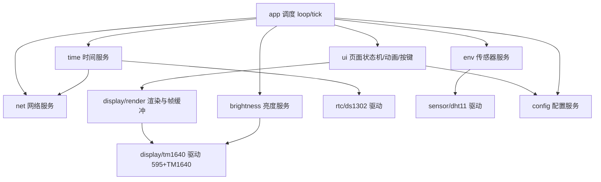
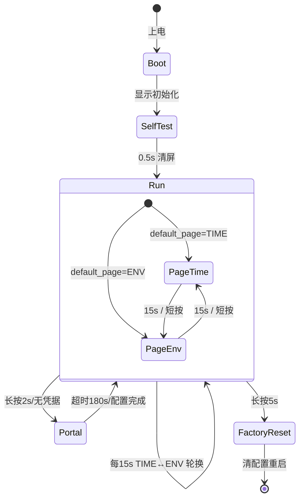

# 设计文档 v1.0（定稿）

| 项 | 内容 |
|---|---|
| 依据 | [需求基线 requirements.md](requirements.md) v1.4；[硬件设计](hardware-design.md) |
| 实现 | PlatformIO + Arduino（espressif8266），全新实现（参考代码仅功能参考） |
| 状态 | v1.0 定稿（2026-10-14）：P1–P8 已全部实施（§14），单测/编译通过，硬件统一联调待进行 |

---

## 1. 架构总览

分层原则：驱动层只做时序与寄存器操作，服务层做业务策略，表现层做渲染与交互；
上层可调用下层，禁止反向依赖；渲染层可在无硬件的 `native` 环境单测。



## 2. 调度模型

单线程协作式：`loop()` 每圈调用各任务的 `tick()`，全部用 `millis()` 截止时间驱动，
**禁止 `delay()`**（DHT11 的 18ms 起始信号也用状态机完成）。主循环单圈 ≤20ms
（含刷新帧 ~15ms），满足 50ms 画帧预算。

| 任务 | 周期 | 职责 |
|---|---|---|
| buttonPoll | 10ms | 消抖、短按/长按 2s/5s 事件 |
| refresh | 50ms | `Renderer::flush()` 整屏刷新 |
| clockTick | 1s | 读 RTC→推进显示时间、触发数字滚动、冒号相位 |
| envSample | 3s | 启动 DHT11 采样事务 |
| pageRotate | 1s | TIME↔ENV 轮换计时判定（`page_switch_s`，短按重置计时） |
| dateScroll | 30min | 触发日期水平滚动动画（~7s 周期） |
| brightnessTick | 1s | A0 采样→8 档映射→TM1640 |
| netTask | 1s | WiFiManager `process()`、STA 重连、Web 服务启停、SNTP→写 RTC |
| webTick | 每圈 | Web 配置请求处理（`handleClient`） |

## 3. 显示子系统

### 3.1 TM1640 指令摘要（手册 P5–P7，已核实）

| 指令 | 字节 | 说明 |
|---|---|---|
| 数据命令 | `0x40` | 地址自动加 1（普通模式）；`0x44` 固定地址 |
| 地址命令 | `0xC0+n` | n=0..15，上电默认 `0xC0` |
| 显示控制 | `0x90+lv` | 显示开 + 亮度 lv=0..7（脉宽 1/16,2/16,4/16,10/16,11/16,12/16,13/16,14/16） |
| 显示关 | `0x80` | B4=0 显示关 |

- 自动地址写事务：`Start, 0x40, End, Start, 0xC0+n, data1..16(≤16B), End`。
- 显存映射：地址 `0xC0+n` = GRID(n+1)；字节 bit k = SEG(k+1)。
- **上电必须显存清零**（手册建议，否则开屏出乱码）→ `begin()` 写 16×0x00。
- 中途 End 会使当前指令/数据作废（容错行为）。

### 3.2 595 帧与写事务

帧字节：D0–D3 = SEL1–4（经 74HCT08 门控各片 SCLK）、D4 = DIN，MSB 先行移入 595。
硬性规则（来自硬件设计）：数据相位 DIN 只在 SCLK 低电平变化；**Start/End 构造的
DIN 跳变必须落在 SCLK 高电平**（协议条件本身）；切片先清后置。每 bit：595 移位
8 clk + RCLK + TM1640 clk 高低（半周期 2µs）≈ 25µs；单片写 16B ≈ 4ms，四片整屏 ≈ 15ms。

### 3.3 显存映射与坐标变换

屏幕坐标 `(x∈[0,32), y∈[0,8))`，模块 `m = x/8`，列 `c = x%8`：

| 颜色平面 | TM1640 显存位置 |
|---|---|
| 红 | `RAM[m][c]` bit y（GRID c+1） |
| 绿 | `RAM[m][8+c]` bit y（GRID c+9） |

红/绿列分配为驱动层常量，随实物接线调整。方向变换（normal/rot180/mirror_h/mirror_v）
在 `setPixel()` 入口统一应用（rot180: `(x,y)→(31-x,7-y)`；mirror_h: `x→31-x`；
mirror_v: `y→7-y`），渲染层坐标恒定，`flush()` 只做转置与下发。

### 3.4 渲染层 API（`display/render`）

换芯片约束（R-DRV-07）：渲染层只暴露设备无关读取——`rowBits(平面, 模块, 行)` 行位图
与 `rowBitsLit()`（红|绿合并，单色后端忽略颜色用）；TM1640 GRID/SEG 显存映射下沉到
驱动侧 `display/tm1640_map.h`（纯函数，可单测）；后端统一实现 `DisplayDevice` 接口
（`display/display_device.h`：begin/writeFrame/setBrightness/setDisplayOn）。
换 MAX7219 等芯片时只新增后端实现，8×8 模块拓扑与渲染/页面层不动。

```cpp
// 渲染（纯逻辑，native 可单测）：设备无关
enum class Color : uint8_t { OFF, RED, GREEN, ORANGE };   // ORANGE = 双色同亮

class FrameBuffer {
 public:
  void clear(Color c = Color::OFF);
  void setPixel(int16_t x, int16_t y, Color c);   // 方向变换 + 越界裁剪
  void drawChar(char ch, int16_t x, int16_t y, Color c, FontKind f);
  void drawText(const char* s, int16_t x, int16_t y, Color c, FontKind f);
  uint8_t rowBits(Plane p, uint8_t module, uint8_t row) const;  // 后端读取
  uint8_t rowBitsLit(uint8_t module, uint8_t row) const;        // 单色合并
};

// 显示后端接口（换芯片只实现它；单色后端忽略颜色平面）
class DisplayDevice {
 public:
  virtual void begin(uint8_t brightness) = 0;
  virtual void writeFrame(const FrameBuffer& fb) = 0;
  virtual void setBrightness(uint8_t level) = 0;
  virtual void setDisplayOn(bool on) = 0;
};

// 门面：绑定后端；自检、刷新
class Display { explicit Display(DisplayDevice& dev); void flush(const FrameBuffer&); ... };
```

### 3.5 字库

字库三部分（布局稿 §1）：**大数字 4×7**（TIME 时/分，七段数码管样式，自制取模）、
**小数字/符号 3×5**（TIME 秒、ENV 数值与 `°C`/`%`/`-`/`A`/`P`，七段样式，自制取模，
小数点为 1×1 落间隙列）；**英文与日期行**用开源 glcdfont 5×8（BSD-3，**全量引入
0x20–0x7F，无需按用字裁剪**，仅需保留版权头）。数据格式 `{字宽, 行数据}`。
**不使用参考代码字模**。

### 3.6 动画模型

| 动画 | 模型 |
|---|---|
| 数字垂直滚动 | 数字位各自持有滚动进度 0..7，每 50ms 一步，新旧字形上下平移合成 |
| 日期水平滚动 | `d_PosX` 每 50ms 步进，全周期 ~7s（参考行为），30min 触发 |
| 冒号闪烁 | 1Hz 相位（亮 500/灭 500），`colon_blink=0` 时常亮 |
| 页面切换 | 直切 + 重置 15s 计时（淡入为可选项） |

## 4. 时间（`rtc` + `net` 协作）

实现落点：`rtc/ds1302`（驱动 + 校验）与 `net/net_service`（SNTP 时间源）；
主程序负责「SNTP → 写 RTC」节拍（开机一次 + `ntp_interval_h` 周期，R-RTC-07）。

```cpp
// rtc/datetime.h（纯逻辑）：时间结构 + 校验 + 24h→12h
struct DateTime { uint16_t year; uint8_t mon, day, hour, min, sec, wday; };
bool validDateTime(const DateTime& t);   // 越界拒绝（R-RTC-06）
uint8_t to12h(uint8_t hour24, bool* pm);

// rtc/ds1302：三线驱动（CE=4 / SCLK=2 / IO=16）
bool readTime(DateTime& out);            // 读 + 校验，失败保持上次值
bool writeTime(const DateTime& t);       // 写保护、秒寄存器 CH 位处理

// net/net_service：SNTP 时间源（configTime 注入时区）
bool now(DateTime& out) const;           // 未同步返回 false
```

- NTP 用 Arduino core 内置 SNTP（`configTime`），不手写 UDP（原待确认 #2，已定）。
- 时区：`tz_offset_min`（默认 480），不做夏令时。

## 5. 传感器服务（`sensor` + `ui/comfort`）

```cpp
// sensor/dht_decode.h（纯逻辑）：帧解码 + 型号判别
enum class DhtType { UNKNOWN, DHT11, DHT22 };
bool dhtChecksumOk(const uint8_t raw[5]);
bool dhtFrameLooksDht22(const uint8_t raw[5]);               // 粘滞判别线索
bool dhtDecodeFrame(const uint8_t raw[5], DhtType type, DhtReading& out);

// sensor/dht：采样状态机（18ms 起始 + ~4ms 关中断读取突发）
bool startSample(uint32_t nowMs);
void tick(uint32_t nowMs);
int16_t temperatureTenths() const;   // 0.1℃（DHT11 恒 .0，DHT22 有效）
uint8_t humidity() const;            // %

// ui/comfort.h（纯逻辑）：R-ENV-05 查表
Color comfortColorTemp(int16_t tenths);
Color comfortColorHum(uint8_t percent);
```

- **DHT11/DHT22 自动判别**：两型号帧格式相同但解码公式不同（DHT11 `int×10+dec`，
  DHT22 `(h<<8|l)`），小数字节非零/越出 DHT11 量程 → 锁定 DHT22；连续 4 帧全零小数 → DHT11。
- 失败处理：校验/超时保留上次值；从未成功过显示 `--`（R-ENV-03）。
- 舒适度表（硬编码常量）：温度绿 18–26 / 橙 12–17、27–30 / 红其余；
  湿度绿 40–70 / 橙 30–39、71–80 / 红其余。

## 6. 网络服务（`net`）

```cpp
class NetService {
 public:
  void begin(int16_t tzOffsetMin, const char* ntpServer);  // STA + configTime
  void tick();                 // WiFiManager process() + 断线重连状态机
  void startPortal();          // SoftAP 配网页（长按 2s / 无凭据自动进入），180s 超时
  bool connected() const;
  bool now(DateTime& out) const;   // SNTP 时间源
};

// net/web_config：Web 配置服务（P8 / R-WEB）
class WebConfig {
 public:
  void begin(ConfigStore& store);  // 80 端口常驻（STA 连接后）
  void stop();                     // 配网时让位 WiFiManager
  void tick();                     // handleClient
};
```

- 库：`tzapu/WiFiManager`（lib_deps 锁定 ^2.0.17），非阻塞 `process()` 模式。
- 配网成功：保存凭据（SDK flash）→ 重启进 STA；超时退出继续走时（提示 `RTC!`）。
- Web 配置（R-WEB）：13 项中文表单 + 恢复出厂；保存经 `config::fromJson` 校验/越界收敛；
  与配网页互斥 80 端口（配网期间本服务停止）。
- 状态提示沿用参考文案：`Wi-Fi`（连接中）/`OK!!`/`Err!`/`Setup`/`RTC!`，顶层覆盖层。

## 7. 配置服务（`config`）

```cpp
struct Config {
  int16_t  tz_offset_min = 480;
  char     ntp_server[32] = "time1.aliyun.com";
  uint8_t  ntp_interval_h = 6;
  uint8_t  hour_format = 24;      // 12 | 24
  uint8_t  date_order = 0;        // 枚举：YYYY MM DD WT（默认）/ 其他
  uint8_t  rotate_mode = 0;       // normal | rot180 | mirror_h | mirror_v
  uint8_t  colon_blink = 1;
  uint8_t  brightness_mode = 0;   // auto | manual
  uint8_t  brightness_level = 5;  // 0..7
  uint8_t  default_page = 0;      // TIME | ENV
  uint16_t page_switch_s = 15;
  uint8_t  env_sample_s = 3;
  uint16_t date_scroll_min = 30;
  uint32_t schema = 1;            // 版本号，不符→默认值
};
```

- 存储 LittleFS `/config.json`（ArduinoJson）；损坏/版本不符→默认值+串口日志。
- `save()` 修改后写入；恢复出厂 = 删除文件 + 重启（长按 5s）。
- WiFi 凭据由 WiFiManager 独立管理，不入本结构（R-CFG-05）。

## 8. 按键（`ui/button`）

```cpp
enum class KeyEvt : uint8_t { NONE, SHORT, LONG_2S, LONG_5S };
KeyEvt buttonPoll();   // 10ms 调用；按下计时分级，松开判定短按
```
映射：SHORT→立即换页（重置 15s）；LONG_2S→`startPortal()`；LONG_5S→恢复出厂。

## 9. UI 状态机



状态数据：`page`、`pageDeadline`、各位数字滚动进度、`dateScrollX`、冒号相位、
顶层提示覆盖（配网/错误文案，优先级高于页面）。

## 10. 上电流程

1. 引脚安全初始化：GPIO15=低、GPIO12=低（RCLK）、GPIO4=低（CE），再 595/TM1640
   `begin()`（含显存清零）、亮度默认档。
2. `config.load()` → 应用方向/亮度/闪烁/默认页。
3. RTC `begin()` + `now()` → 立即渲染目标页（**≤3s 达成，不等网络**）。
4. 启动节拍任务；后台 `net.begin()`（显示 `Wi-Fi` → 成功 `OK!!` → NTP→写 RTC）。
5. 自检图案（0.5s）在步骤 1–3 间显示，可跳过（R-UI-11）。

## 11. 性能与内存预算

| 项 | 预算 | 依据 |
|---|---|---|
| 整屏刷新 | ~15ms（≤50ms） | 4 片 × 160bit × 25µs（§3.2） |
| 主循环单圈 | ≤20ms | 含刷新；其余任务 µs 级 |
| 常驻 RAM | ≤1KB | 帧缓冲 2×64B + 显存镜像 2×64B + Config ~120B + 状态机 |
| Flash | LittleFS 64KB 分区 | config.json <1KB；字库 ~2KB PROGMEM |

优化预留：固定地址模式（`0x44`）只写变化字节，可把刷新降到 <5ms（v2 不做）。

## 12. 错误处理

| 故障 | 处理 |
|---|---|
| DHT11 校验失败 | 保留上次值；连续 3 次显示 `--`；不阻塞主循环 |
| RTC 读值越界 | 拒绝更新，保持上次有效时间（R-RTC-06） |
| NTP 失败/断网 | RTC 继续走时；6h 后重试；显示不中断 |
| WiFi 断线 | 重连状态机（间隔退避）；不影响显示 |
| config.json 损坏 | 默认值 + 串口日志；可恢复出厂 |
| WDT | 禁长阻塞；`yield()` 于长事务间隙 |

## 13. 测试计划

- **单测（PlatformIO `native` env，无硬件）**：渲染转置/方向变换、双色合成、
  BCD 编解码、舒适度查表边界（17/18/26/27℃、39/40/70/71%）、Config JSON
  读写/版本回退、日期滚动步进。
- **硬件联调（对照需求验收 §7）**：上电时序（逻辑分析仪验 TM1640 Start/Data/End
  与 RCLK 窗口）、走时精度、对时、配网、按键三档、亮度跟随、24h 稳定性。

## 14. 开发阶段与提交计划（P1–P8 已全部实施）

| 阶段 | 内容 | 验收 |
|---|---|---|
| P1 | PlatformIO 工程骨架、调度框架、config 服务 | 编译通过；config 单测 |
| P2 | display 驱动 + 渲染 + 字库（gen_font 生成 + glcdfont 收录）+ 自检 + **显示验收固件 esp12e_fonttest** | 全字形/颜色/方向/亮度巡回检视、单测转置与方向变换、双固件编译通过 |
| P3 | DS1302 + PAGE_TIME（大字时间+小秒+冒号+12/24h） | 走时正确、冒号闪烁开关生效 |
| P4 | DHT11 + PAGE_ENV + 舒适度着色 + 15s 轮换 | 采样 3s、着色边界、轮换/短按 |
| P5 | 按键 + 5516 自动亮度 + 动画（垂直/日期滚动） | 验收 #2/#4/#8 |
| P6 | WiFiManager 配网 + NTP 对时写 RTC + 重连 | 验收 #5/#6 |
| P7 | 配置接线收尾、恢复出厂、状态提示、自检 | 验收 #1–#9 全过 |
| P8 | Web 配置服务（ESP8266WebServer，独立于配网页） | 13 项表单编辑/保存/恢复出厂，与配网页互斥 80 端口 |

提交规范（每阶段一次提交）：

```
<English summary：祈使句 ≤72 字符>

<English description：要点列表——做了什么、关键决策、影响面>
```

代码注释一律中文；示例：`Implement display driver and renderer` +
`- Bit-bang 74HCT595 frame protocol and TM1640 Start/Data/End timing` …

## 15. 决议与遗留点

| # | 问题 | 结论 |
|---|---|---|
| 1 | 字库来源：自制 vs 开源 | 已定：glcdfont 5×8（英文/日期，BSD-3）+ 自制取模数字/符号（大 4×7、小 3×5，七段样式，`tools/gen_font.py` 生成） |
| 2 | NTP 实现：内置 SNTP vs 手写 UDP | 已定：内置 SNTP（`configTime`） |
| 3 | WiFiManager 版本锁定 | 已定：`platformio.ini` lib_deps 锁 ^2.0.17 |
| 4 | 双色接线映射：GRID1–8=红列 / GRID9–16=绿列 | **遗留（硬件联调确认）**：现按此映射，驱动层常量随实物接线可调 |
| 5 | UI 像素布局稿流程 | 已定：[ui-layout.md](ui-layout.md) v1.0 定稿，已按稿实现（`ui_layout.h` + 字模生成器） |
