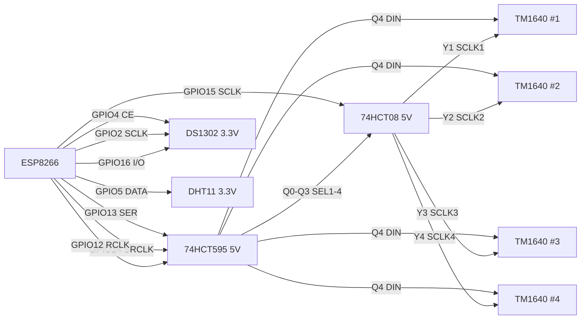

# 硬件设计 — LED 矩阵时钟（ESP8266）

ESP8266 驱动 4 块共阳双色 8×8 点阵（每块 1 片 TM1640），74HCT595 扩展片选/数据，
DS1302 时钟，DHT11 温湿度。本文档为**定稿电路方案**：ESP8266 引脚分配不变，
修改的是互连拓扑与电源域（见「方案改动」）。

参考数据手册：`../hardware/datasheet/TM-TM1640_V1.5.pdf`（电气参数 P2、接口说明 P4）。

## 方案改动（相对原方案）

| 项 | 原方案 | 定稿方案 | 原因 |
|---|---|---|---|
| TM1640 SCLK | GPIO15 直驱 | GPIO15 → 74HCT08 与门 → 各片 SCLK | TM1640 VIH ≥ 0.7·VDD = 3.5V@5V，GPIO 3.3V 不达标 |
| TM1640 DIN | 595 4 路各驱一片（DIN 片选） | 595 Q4 单路并联 4 片 | 电平转换免费（595 输出 5V） |
| 片选方式 | 靠 DIN 选通 | 595 Q0–Q3 → 与门 gate SCLK（真片选） | 未选中芯片零时钟沿，无误码，无需依赖 Start/End 丢弃行为 |
| DS1302 供电 | 未明确 | 强制 3.3V | I/O 输出高电平可达 VCC，5V 会灌入 GPIO16（ESP8266 不容忍 5V） |
| DHT11 供电 | 未明确 | 强制 3.3V + 上拉到 3.3V | 同上（DATA 上拉到 5V 即 5V 入 GPIO5） |
| GPIO4（CE） | 悬空 | 10k 下拉 | 上电初始化前 CE 高阻，防误动作 |

选型约束：5V 域必须用 **HCT** 器件（输入 TTL 阈值 VIH ≥ 2.0V，3.3V GPIO 可靠驱动；
输出 ≈5V 满足 TM1640 VIH=3.5V）。若整机 3.3V 供电则改用 74HC595/74HC08，但 TM1640
手册按 VDD=4.5–5.5V 测试，亮度与驱动电流指标下降，不采用。

## 系统框图

## 电源域

| 域 | 器件 | 说明 |
|---|---|---|
| 5V（≥2A） | TM1640 ×4、74HCT595、74HCT08 | TM1640 SEG 拉电流 45–65mA/脚、GRID 灌电流 typ 140mA |
| 3.3V（LDO ≥500mA） | ESP8266、DS1302（VCC2）、DHT11 | WiFi 发射峰值 ~350mA，LDO 余量要足 |
| 3V 电池 | DS1302（VCC1） | CR2032，VCC2 掉电时维持走时 |

5V 与 3.3V 共地。每片 TM1640 旁 100nF + 10µF；595/08 旁 100nF。
TM1640 封装功耗上限 400mW、GRID 单脚 140mA：固件限制辉度档位与同亮 LED 数，
必要时在 SEG 线预留 100–220Ω 限流电阻位。

## ESP8266 引脚分配（固件引脚表，定稿）

| GPIO | 功能 | 连接 | 上拉/下拉 |
|---|---|---|---|
| 13 | 595 SER（数据） | 74HCT595 SER(14) | — |
| 14 | 595 SRCLK（移位时钟） | 74HCT595 SRCLK(11) | — |
| 12 | 595 RCLK（锁存） | 74HCT595 RCLK(12) | 10k 下拉 |
| 15 | TM1640 共享 SCLK | 74HCT08 1A–4A（4 输入并接） | 10k 下拉（boot 必须低） |
| 4 | DS1302 CE/RST | DS1302 CE | 10k 下拉 |
| 2 | DS1302 SCLK | DS1302 SCLK | 10k 上拉（boot 必须高） |
| 16 | DS1302 I/O | DS1302 I/O（双向） | — |
| 5 | DHT11 DATA | DHT11 DATA | 10k 上拉到 3.3V |
| 0 | BOOT 按键 / 用户按键 | 按键 → GND | 10k 上拉（boot 必须高） |
| 1 / 3 | UART TX/RX | 调试/下载，保留 | — |
| A0 | 光敏自动亮度 | 5516 光敏电阻 + 分压（见「其他外围」） | — |

自举（boot strapping）结论：GPIO15 经与门输入接 TM1640 SCLK（输入电流 ≤±1µA，
无内部上拉），GPIO2 接 DS1302 SCLK（输入脚，CE 低时 DS1302 不动作）——
两者都不驱动总线，与 boot 电平要求不冲突；可靠性由 10k 上拉/下拉保证（ESP-12
模组一般自带，需确认，不足则补）。

## 74HCT595 输出帧

| 输出 | 信号 | 去向 |
|---|---|---|
| Q0 | SEL1 | 74HCT08 1B |
| Q1 | SEL2 | 74HCT08 2B |
| Q2 | SEL3 | 74HCT08 3B |
| Q3 | SEL4 | 74HCT08 4B |
| Q4 | DIN | 4 片 TM1640 DIN 并联 |
| Q5–Q7 | 备用 | 可接指示灯/扩展 |

- 帧字节位定义：D0=SEL1 … D3=SEL4，D4=DIN，D5–D7=0。
- 移位顺序：**MSB 先行**（先送 D7，最后送 D0；D7 落 Q7 … D0 落 Q0）。
- /OE(13) 接 GND，SRCLR(10) 接 5V。
- 74HCT08：1A–4A 全接 GPIO15；Y1–Y4 → 各片 TM1640 SCLK；VCC=5V。
  与门 = 电平转换（TTL 输入阈值）+ 片选（SEL=0 时输出恒低）。

## 驱动时序与片选协议

TM1640 手册（P2/P4）：数据 LSB 先行；DIN 仅在 SCLK 低电平变化，SCLK 高电平采样；
Start = SCLK 高时 DIN↓；End = SCLK 高时 DIN↑；Fmax=1MHz，PWCLK≥400ns，
tSETUP/tHOLD≥100ns，tWAIT≥1µs，PWSTB≥1µs。固件半周期取 ≥2µs 即全部覆盖。

单片传输（SELn=选中）：

1. 空闲：SCLK=0、DIN=0。
2. Start：DIN=1（SCLK=0）→ SCLK=1 → DIN=0。
3. 数据：逐字节 8 bit（LSB 先行）；每 bit 先在 SCLK=0 时改 DIN，再拉高 SCLK 采样，拉低。
4. End：SCLK=1 → DIN=1 → SCLK=0。
5. 典型命令序列：`Data Setting(0x40)` → `Address(0xC0)+16B 显存` → `Display ON(0x8x)`。

硬性约束：

- **RCLK（595 锁存）只允许在 GPIO15=0 时触发**，即更新 DIN/SEL 必须在 TM1640
  时钟低电平窗口内，否则 DIN 跳变落在时钟高电平上会被判成 Start/End。
- 切换片选：SCLK=0 时先清当前 SEL，再置新 SEL，然后才可开始新的 Start。
- 未选中芯片 SCLK 被与门钳在低电平，完全不感知 DIN 上的任何跳变。

## 其他外围

- **DS1302**：VCC2=3.3V（主电）、VCC1=CR2032（备电）、X1/X2=32.768kHz（CL=6pF）、
  CE ← GPIO4、SCLK ← GPIO2、I/O ↔ GPIO16。**禁止 5V 供电**。I/O 为双向脚，
  固件按开漏方式切换方向（输出时 pinMode OUTPUT，释放时 INPUT）。
- **DHT11**：VCC=3.3V，DATA ← GPIO5，10k 上拉到 3.3V。**禁止 5V 供电/上拉**。
- **A0 光敏**：5516 光敏电阻 + 固定电阻（建议 10k）分压接 A0，作自动亮度采样。
  注意 ESP-12E/F 的 A0（TOUT）量程 **0–1.0V**（模组无板载分压）；分压输出不得超过
  1.0V。若用 NodeMCU/WeMos 类开发板（板载分压，量程 0–3.3V），分压参数按板型调整。
  光敏与固定电阻的上下位置决定"光强↑电压↑/↓"，方向由固件适配。
- **TM1640 ×4**：DIN 并联 ← 595 Q4；SCLK ← 各自与门输出；
  SEG1–8 → 8 个共阳极（P 管开漏，出电流）；GRID1–16 → 16 个阴极，8 红 + 8 绿
  （N 管开漏，灌电流）。8×16 = 128 点 = 双色 8×8，极性与共阳屏匹配。

## 设计约束与风险

- GPIO2 是 UART1 TX：固件**禁用 `Serial1`**，否则打印即扰动 DS1302 时钟线。
- GPIO12/13/14 即 HSPI 的 MISO/MOSI/SCLK：占用后不能再用硬件 SPI（如 SD 卡）。
- GPIO16 无外部中断，且是 deep-sleep 唤醒专用（GPIO16→RST）：本设计占用后
  不能使用 deep-sleep。
- GPIO0 按键在复位时被按住会进入下载模式：产品化需在结构/按键逻辑上规避。
- 上电瞬间 595 输出未定义：因 SCLK 恒低，TM1640 不会执行任何指令；RCLK 加
  10k 下拉可进一步抑制锁存噪声，属防御性设计。

## 上电检查

1. 复位期间量 GPIO15=低、GPIO2=高、GPIO0=高；GPIO4=低。
2. 空闲时 4 片 TM1640 SCLK 均为低，DIN 稳定。
3. 逻辑分析仪确认：Start/Data(LSB 先行)/End 结构、RCLK 仅出现在 SCLK 低电平窗口、
   切片时无毛刺。
4. 全亮压力测试：5V 轨压降、TM1640 温升、辉度档位是否需下调。

## 备选方案（不推荐）

退回 DIN 片选：595 Q0–Q3 各驱一片 DIN，SCLK 经 74HCT125（5V）缓冲直驱。
要求未选中 DIN 恒为低、切片只能在 SCLK 低电平期间；未选中芯片仍会看到时钟沿，
只能靠无 Start/End 而丢弃数据，鲁棒性弱于与门 gate SCLK，故不采用。
